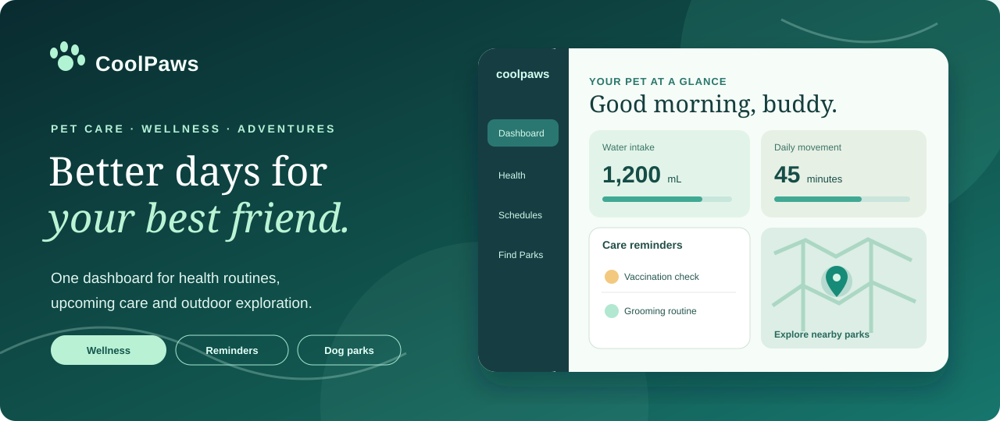
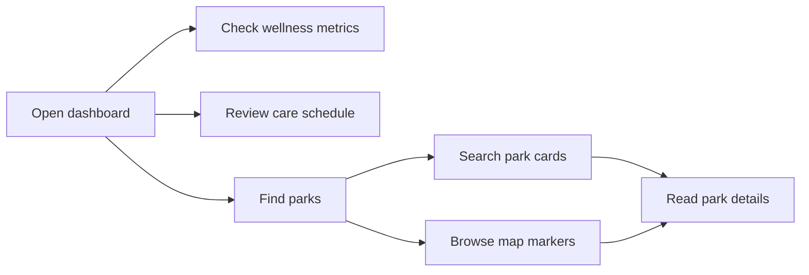
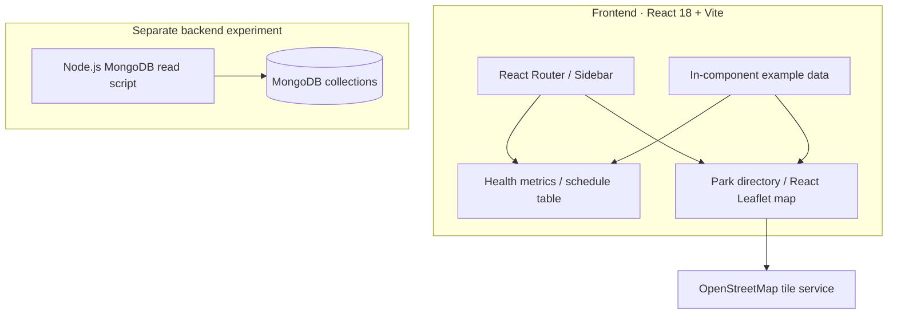

<div align="center">
  
  <h1>CoolPaws 🐾</h1>
  <p><strong>Better days for your best friend.</strong></p>
  <p>A pet-care dashboard concept combining everyday wellness, care schedules and places to explore with your dog.</p>
  <p><strong>Independently hand-coded · Pre-AI-assisted development portfolio project</strong></p>
  <p><a href="#features">Explore features</a> · <a href="#run-locally">Run locally</a> · <a href="#architecture">Architecture</a></p>
  <p>
    
    
    
    
  </p>
</div>

> **Portfolio note:** This is an earlier project I built by writing the application code myself, before AI coding assistants became part of my development workflow. The cover above is an **original illustration**, not a captured screenshot. This repository is a historical prototype rather than a production pet-health service.

---

## Why CoolPaws?

Being a pet owner means keeping track of a lot of small things: making sure a dog stays active and hydrated, remembering vaccination and grooming appointments, and finding good places to go outside.

**CoolPaws explores what happens when those everyday needs share one interface.** Rather than scattering reminders, health metrics and park research across separate tools, the project brings them together into an approachable pet-care workspace.

The goal was also technical: build a multi-page React experience from reusable components, with state-driven UI elements, a searchable card collection, data tables and an interactive map.

## Features

| Experience | What the code demonstrates |
| --- | --- |
| **Pet-care dashboard** | Combines the health-monitoring and care-schedule panels into a single view. |
| **Wellness metrics** | Water intake and physical-activity metric cards with progress-bar visuals and a daily/weekly/monthly selector. Values are illustrative rather than collected from sensors. |
| **Care schedule** | A table of example vaccination, parasite-prevention, grooming, feeding and hydration items, with statuses and action labels. |
| **Find parks & trails** | Quick-access activity cards and a searchable directory of sample dog parks with descriptions, ratings and amenities. |
| **Interactive map** | React Leaflet map with OpenStreetMap tiles, sample markers and park-information popups. |
| **Navigation system** | React Router routes and a sidebar connecting the implemented dashboard, monitoring, schedules and parks pages. |

### The product journey



### Visual identity & interface components

<table>
  <tr>
    <td align="center"></td>
    <td align="center"></td>
    <td align="center"></td>
    <td align="center"></td>
  </tr>
  <tr>
    <td align="center"><strong>Brand</strong></td>
    <td align="center"><strong>Health</strong></td>
    <td align="center"><strong>Schedules</strong></td>
    <td align="center"><strong>Explore</strong></td>
  </tr>
</table>

<small>The icons above are assets already present in the original repository. The cover is a designed illustration of the concept; it should not be interpreted as proof of currently connected real-world data.</small>

## Engineering highlights

The emphasis of this project was on building the UI **component by component**, rather than generating a scaffold from a product prompt:

- **Reusable React components:** composed a dashboard from focused components such as <code>Healthmonitor</code>, <code>Metric</code>, <code>Reminders</code>, <code>Parkcard</code> and <code>Parkmap</code>.
- **Client-side state:** implemented input-driven park filtering and time-frame selectors using React state.
- **Maps and geospatial UI:** rendered map tiles, markers and popup cards with React Leaflet.
- **Structured data presentation:** built a schedule table using Material React Table, including nested accessors for task metadata.
- **Navigation and styling:** connected feature screens with React Router and designed layouts and styles in CSS.

## Architecture



| Area | Technologies |
| --- | --- |
| UI | React 18, JavaScript, CSS |
| Dev/build tooling | Vite 5 |
| Routing | React Router 6 |
| Maps | Leaflet, React Leaflet, OpenStreetMap |
| UI/data display | Material UI, Material React Table |
| Backend exploration | Node.js, MongoDB driver / MongoDB-related dependencies |

**Important distinction:** the repository contains a **separate MongoDB read script**, not a working Express REST API connected to the React interface. The visible health values, care tasks and parks come from front-end example data. No real-time sensor integration, pet account persistence or live park-data service is demonstrated.

## Run locally

The **frontend** can be explored independently of the database prototype.

**Prerequisites:** a supported Node.js / npm installation (Node.js 20 is a reasonable starting point for this legacy Vite project).

```bash
git clone https://github.com/Roxyh-code/CoolPaws.git
cd CoolPaws/frontend
npm install
npm run dev
```

Open the local URL printed by Vite (usually <code>http://localhost:5173</code>).

To produce a frontend bundle:

```bash
npm run build
```

The original repository also contains <code>backend/</code>, but **do not run the historical MongoDB script as-is**: its database connection details were hard-coded in source. Rotate any still-valid credentials and refactor the script to load a newly issued connection string from an ignored environment variable before attempting database access. The frontend does not require this script.

> **Legacy-code note:** This README documents the code currently in the repository; it does not claim a fresh-install smoke test or production compatibility with current dependency versions. Some legacy paths/imports may require maintenance on case-sensitive systems.

## Repository structure

```text
CoolPaws/
├── frontend/
│   ├── src/
│   │   ├── App.jsx               # Routes and main layout
│   │   ├── pages/
│   │   │   ├── Dashboard/
│   │   │   ├── Healthmonitoring/
│   │   │   ├── Schedules/
│   │   │   └── Listandmap/
│   │   ├── components/
│   │   │   ├── Healthmonitor/
│   │   │   ├── Metric/
│   │   │   ├── Reminders/
│   │   │   ├── Parkcardlist/
│   │   │   ├── Parkmap/
│   │   │   └── Sidebar/
│   │   └── assets/
│   └── package.json
├── backend/                       # Historical MongoDB script
└── docs/assets/                   # README illustration
```

## What is prototype-only?

- **Health figures and schedule entries** are illustrative; selecting a time range does not fetch another dataset.
- **Park names, ratings and locations** are example records. The map's marker coordinates are sample locations, not a geolocated directory of actual nearby dog parks.
- Some links in the sidebar, including Pet Profile, Settings and Documentation, are visible navigation concepts without corresponding registered routes.
- The login/sign-up component is a UI mockup, not a verified authentication system.
- No deployed product, automated test suite or production data pipeline is documented.

## What this project represents

CoolPaws is a snapshot of how I approached product development through **hands-on React engineering**: breaking a problem into screens, designing reusable components and assembling an end-to-end user experience with routing, tables and maps.

The value of the project is in its **interface composition, component structure and early full-stack exploration**, not in claims of production-scale pet healthcare functionality.

---

Built by hand as a learning/portfolio project. See the [source code](frontend/src/) or open an [issue](https://github.com/Roxyh-code/CoolPaws/issues) to discuss the implementation.
